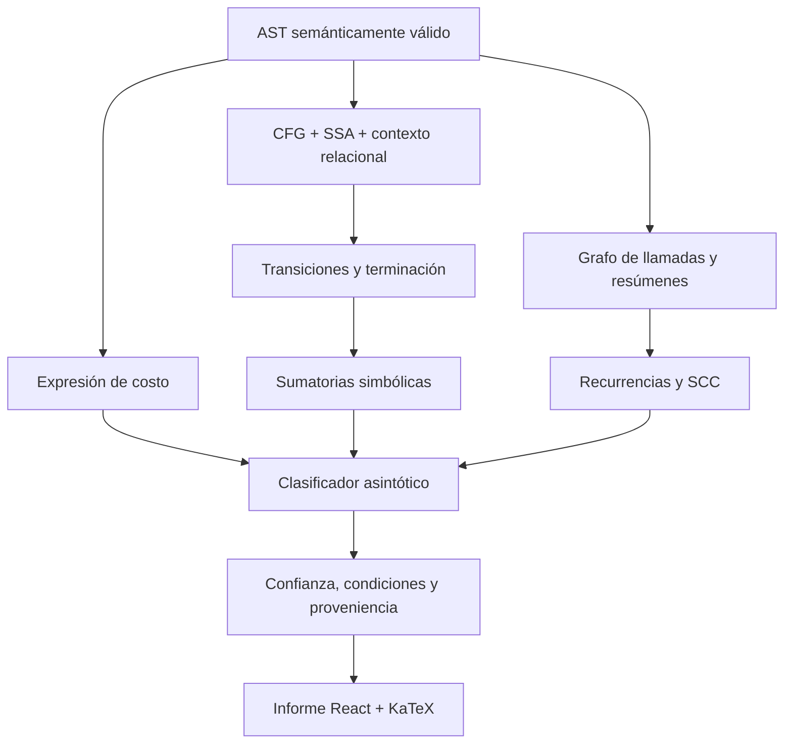

# Análisis de complejidad

Las funciones GUI tienen modelos canónicos de trabajo directo. La espera humana,
el renderizado y la frecuencia de eventos no se convierten en costos constantes
de la sesión completa. Estado nativo o tamaños no demostrados conservan su
incertidumbre. Las fórmulas, medidas y límites se mantienen en el
[modelo de costos GUI](../../test/fixtures/gui/cost-model.md).

## Complejidad algorítmica

El módulo `src/complex/` no es un único clasificador: construye y transforma evidencia en varias capas.

| Capa | Carpetas o archivos |
|---|---|
| Costos exactos | `CostAnalysisVisitor`, `algebra/` |
| Estado abstracto | `abstract-domain/`, `control-flow/` |
| Escenarios | `scenario/`, `soundness/` |
| Ciclos | `iteration/`, `summation/` |
| Funciones | `function-summary/`, `function-semantics/`, `call-graph/` |
| Recurrencias | `recurrence/` |
| Clasificación | `asymptotic/` |
| Proveniencia | `provenance/` |
| Cobertura | `coverage/`, `unknown/` |
| Presentación | `report/` |

### Flujo simplificado

### Regla de solidez

`O(?)` o un estado parcial es una respuesta válida cuando no existe una demostración segura. No debe reemplazarse por una clasificación optimista. Toda ampliación debe acompañarse de:

1. prueba positiva;
2. contraejemplo de solidez;
3. prueba metamórfica cuando aplique;
4. causa estructurada para los casos aún no resueltos;
5. actualización del corpus de cobertura.

Un literal de arreglo pertenece a la expresión que lo contiene y no crea por sí mismo una dimensión asintótica variable: su cantidad de elementos está escrita en la fuente. `CostAnalysisVisitor` conserva el costo local de la instrucción y recorre el literal completo para incorporar llamadas anidadas, incluidas las ubicadas dentro de matrices. Cuando el dominio no puede demostrar la relación entre una colección y una medida de entrada, mantiene el valor simbólico desconocido en lugar de inferir una complejidad a partir de su forma visual.

El informe se construye en `ComplexityReportBuilder` y se presenta mediante `frontend/src/report/`. Incluye mejor/peor caso, LaTeX, grafo local, condiciones, cadena interprocedimental y una gráfica adaptativa de crecimiento para cada escenario. El perfil asintótico parte del origen, emplea una escala verde–naranja según la complejidad demostrada y deja el lienzo sin curva cuando el orden es desconocido.

`ComplexityReportController` mantiene una única sesión por informe enlazado. Si el foco está en el propio Webview y ya no existe un editor de texto activo, ejecutar de nuevo `CLRS.showComplexityReport` revela y actualiza el panel existente en su grupo actual, en lugar de crear otra pestaña o devolver un falso error de documento ausente. La sesión puede adoptar otra instancia visible del mismo documento sin perder su URI ni sus listeners.

---

