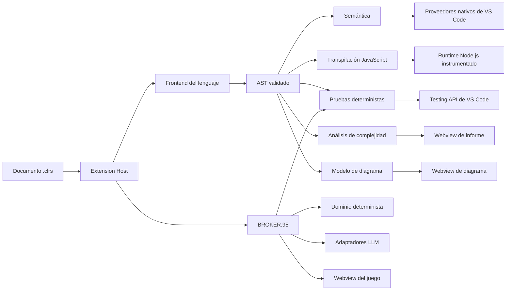

# Arquitectura y composición

## Visión arquitectónica

CLRS Kit Español contiene cinco sistemas principales que comparten el modelo del lenguaje, pero conservan responsabilidades independientes:

| Sistema | Responsabilidad principal | Autoridad |
|---|---|---|
| Lenguaje CLRS | Lexer, parser, AST, semántica, transpilación y runtime. | `src/` |
| Integración VS Code | Comandos, proveedores del editor, terminal, diagnósticos y DAP. | `extension/` |
| Herramientas visuales | Diagrama, informe de complejidad y BROKER.95. | Host en `extension/`; presentación en `frontend/` |
| Pruebas CLRS | Modelo declarativo, descubrimiento, ejecución determinista, resultados nativos y depuración de casos. | Dominio en `src/testing/`; Testing API en `extension/testing/` |
| BROKER.95 | Juego, contratos, aprendizaje, evaluación, economía y LLM. | Dominio en `src/broker95/`; composición y capacidades privadas en el Extension Host |



### Principios estructurales

- **Un frontend compartido:** `src/language/LanguageFrontend.js` es la entrada común para Node.js, VS Code y los consumidores del navegador.
- **AST como frontera estable:** los consumidores operan sobre nodos validados y recorren el árbol mediante visitantes especializados.
- **Composición en los bordes:** `extension/composition/createExtensionApplication.js` es el único punto que conoce simultáneamente VS Code y las implementaciones concretas.
- **Puertos verificables:** las dependencias externas se validan mediante `src/application/ports/ApplicationPorts.js`.
- **Estado inmutable:** especialmente en BROKER.95, cada transición produce una nueva revisión validada antes de persistirse.
- **Webview sin autoridad:** la UI solicita acciones y proyecta estado; no decide puntuaciones, pagos, progreso, contratos ni acceso a archivos.
- **Resultados conservadores:** el analizador de complejidad distingue demostración exacta, cota, condición, parcialidad y desconocimiento.
- **Errores por audiencia:** el usuario recibe mensajes en español; los detalles de implementación y logs para desarrollo conservan inglés cuando corresponde.

---

## Mapa del repositorio

```text
clrs-kit-esp-gpt/
├── extension/              # Adaptación a VS Code y raíz de composición
├── extension-dist/         # Bundles publicados del Host y del CLI
├── frontend/               # Aplicación Vite/React para los tres Webviews
│   ├── src/
│   └── dist/               # Build publicado dentro del VSIX
├── src/                    # Dominio y lógica independiente de VS Code
│   ├── application/
│   ├── ast/
│   ├── broker95/
│   ├── compiler/
│   ├── complex/
│   ├── errors/
│   ├── language/
│   ├── lexer/
│   ├── parser/
│   ├── runtime/
│   ├── semantic/
│   ├── testing/
│   └── standard-library/
├── test/                   # Pruebas unitarias, corpus y Extension Host
├── scripts/                # Empaquetado reproducible
├── package.json            # Manifiesto de la extensión y scripts raíz
├── .vscode-test.mjs        # Configuración de pruebas reales en VS Code
├── .vscodeignore           # Frontera de publicación del VSIX
├── README.md               # Manual para usuarios
└── docs/                   # Documentación técnica modular
```

### `src/`

| Carpeta | Contenido |
|---|---|
| `application/` | Casos de uso, puertos, presentadores y composición reutilizable fuera de VS Code. |
| `ast/` | Nodos, constructores CST→AST, validación, esquemas y `ASTVisitor`. |
| `broker95/` | Dominio completo del videojuego y aprendizaje. |
| `compiler/` | Generación JavaScript, artefactos, runtime, emisión y ejecución. |
| `complex/` | Álgebra de costos, CFG/SSA, ciclos, sumatorias, recurrencias, cobertura e informe. |
| `errors/` | Jerarquía de errores estructurados y formateadores. |
| `language/` | Frontend compartido, sesión documental, diagnósticos e inteligencia. |
| `lexer/` | Tokens Chevrotain e inserción de indentación. |
| `parser/` | Gramática Chevrotain dividida por construcciones. |
| `runtime/` | Captura y reproducción de trazas de ejecución. |
| `semantic/` | Ámbitos, símbolos, bindings, referencias y navegación. |
| `testing/` | Dominio inmutable, formato declarativo, descubrimiento y ejecución determinista de pruebas CLRS. |
| `standard-library/` | Catálogo canónico, ayuda, costo y efectos simbólicos. |

### `extension/`

| Carpeta | Responsabilidad |
|---|---|
| `adapters/` | VS Code, filesystem, Webviews, persistencia, secretos y proveedores LLM. |
| `commands/` | Registro de comandos y proveedores nativos. |
| `composition/` | Construcción completa de la aplicación. |
| `controllers/` | Orquestación de cada capacidad visible. |
| `debug/` | Adaptador DAP y compilación de breakpoints. |
| `getting-started/` | Definiciones inmutables del proyecto inicial y resolución del inicio contextual. |
| `providers/` | CodeLens, decoraciones, símbolos, inteligencia, tokens y rename. |
| `testing/` | Adaptación a la Testing API, perfiles Ejecutar/Depurar, resultados e integración de contratos BROKER.95. |
| `syntaxes/`, `snippets/`, `language-config/` | Integración declarativa del lenguaje. |

### `frontend/src/`

| Carpeta | Responsabilidad |
|---|---|
| `builders/`, `visitor/` | Construcción del modelo Mermaid desde el AST. |
| `renderer/`, `themes/` | Render SVG, temas, estilizado y exportación. |
| `navigation/`, `interaction/`, `execution/` | Zoom, minimapa, selección y reproducción de trazas. |
| `report/` | Informe de complejidad con KaTeX y grafo de llamadas. |
| `broker95/` | Aplicación del juego, aprendizaje, audio, escena Kaplay y accesibilidad. |
| `extension/` | Bridge del diagrama con el Extension Host. |

---

## Activación y composición

La extensión se activa por el lenguaje `clrs-es`, por sus comandos o por una sesión de depuración `clrs`. El código fuente comienza en [`extension/extension.js`](../../extension/extension.js) y es empaquetado como la entrada pública `extension-dist/extension.js`:

1. recibe `ExtensionContext`;
2. llama a `createExtensionApplication`;
3. conserva una única aplicación activa;
4. libera todos los recursos en `deactivate()`.

[`extension/composition/createExtensionApplication.js`](../../extension/composition/createExtensionApplication.js) construye y conecta:

- compilador y frontend;
- análisis documental compartido;
- controladores de código, diagrama, complejidad, depuración y BROKER.95;
- proveedores nativos de VS Code;
- repositorios de `globalState` y `SecretStorage`;
- adaptadores LLM;
- ciclo de vida mediante `DisposableStore`.

Las implementaciones de dominio no deben importar `vscode`. Si una capacidad requiere el editor, un archivo, una terminal o un Webview, se expone mediante un adaptador en `extension/adapters/`.

El manifiesto también activa la extensión cuando un workspace contiene `*.clrs-tests.json`. De este modo el Explorador de pruebas puede descubrir suites sin requerir que el usuario abra primero el programa asociado.

### Comandos de la extensión

| Comando contribuido | Controlador o registro | Función |
|---|---|---|
| `CLRS.runCode` | `CodeCommands` | Compila y ejecuta el documento. |
| `CLRS.stopCode` | `CodeCommands` | Detiene la ejecución normal activa y limpia sus artefactos temporales. |
| `CLRS.generateCode` | `CodeCommands` | Genera el artefacto JavaScript. |
| `CLRS.toggleCost` | `CodeCommands` | Alterna decoraciones y CodeLens de costo. |
| `CLRS.showComplexityReport` | `ComplexityReportCommands` | Abre el informe por función. |
| `CLRS.toggleDiagram` | `DiagramCommands` | Abre o revela el diagrama sincronizado. |
| `CLRS.exportSVG` | `DiagramCommands` | Solicita y guarda el SVG autónomo. |
| `CLRS.debugCode` | `DebugCommands` | Inicia una configuración DAP `clrs`. |
| `CLRS.playBroker95` | `BrokerCommands` | Abre o revela la instancia global de BROKER.95. |
| `CLRS.formatDocument` | `LanguageFormatting` | Formatea el documento CLRS activo. |
| `CLRS.openWalkthrough` | `GettingStartedCommands` | Abre el walkthrough nativo de la extensión. |
| `CLRS.createFirstProgram` | `GettingStartedCommands` | Expone **Crear programa CLRS** y abre una plantilla sin guardar. |
| `CLRS.createFirstTestSuite` | `GettingStartedCommands` | Expone **Crear suite de pruebas CLRS** y abre una definición sin guardar. |
| `CLRS.createExampleProject` | `GettingStartedCommands` | Expone **Crear proyecto CLRS de CLI** y materializa `programa.clrs` con su suite exacta en una carpeta vacía. |
| `CLRS.createGuiProject` | `GettingStartedCommands` | Expone **Crear proyecto CLRS de GUI** y materializa el ejemplo gráfico con su suite en una carpeta vacía. |
| `CLRS.openContextualStart` | `ContextualStartCommands` | Descubre el contexto local y presenta acciones nativas relevantes. |

`CLRS.copyCostExpression` y `CLRS.generateCodeDiagram` son comandos internos registrados para CodeLens y compatibilidad; no aparecen como acciones principales en `editor/title`.

---

