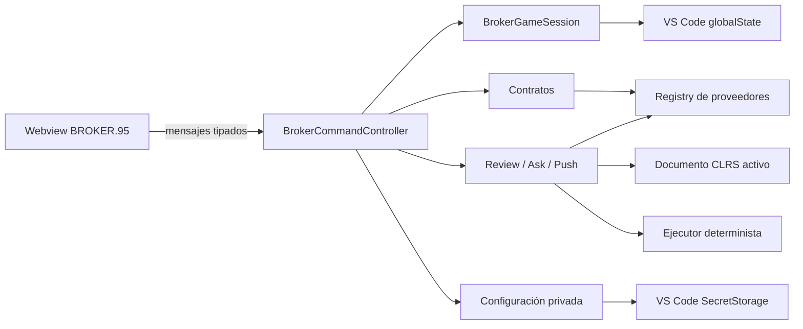

# BROKER.95

Los programas GUI usan la biblioteca estándar y el corredor común. La
evidencia distingue el registro de callbacks de su ejecución observada y no
certifica apariencia visual a partir de stdout. Una infraestructura GUI
incompleta detiene la evaluación antes de calificar o liquidar el contrato.
Autoridad del comportamiento: [pruebas y evidencias GUI](../../test/fixtures/gui/testing-evidence.md).

### Dependencias del frontend

| Dependencia | Uso |
|---|---|
| React 19 | UI y estado de los Webviews. |
| Vite 8 | Build y división de chunks. |
| Mermaid 11 | Diagramas de flujo. |
| `svg-pan-zoom` | Navegación del SVG. |
| KaTeX | Fórmulas de complejidad y lecciones. |
| Kaplay | Escena visual de BROKER.95. |

El código fuente de `frontend/src/` no se publica; el VSIX incluye `frontend/dist/`. Por ello, cualquier cambio visual debe terminar con `npm run build:webview`.

---

## BROKER.95

BROKER.95 está integrado en la extensión. No es una aplicación independiente, no posee editor propio y su terminal `ai` no ejecuta comandos del sistema operativo.

`BrokerCommandController` conserva una sola instancia global del juego por ventana de extensión. Las invocaciones posteriores de `CLRS.playBroker95` revelan esa misma pestaña en el grupo donde el usuario la haya colocado. Cuando se crea desde un editor CLRS activo, el título adopta el formato `BROKER.95 - archivo.clrs` para recordar el enlace inicial; esta etiqueta es informativa y no fija las entregas a ese archivo. `review`, `ask` y `push` continúan resolviendo el documento CLRS activo o el selector explícito proporcionado en la terminal.

### Frontera de autoridad

El Webview sólo recibe proyecciones públicas. Credenciales, filesystem, ejecución CLRS, llamadas de red, validación, puntuaciones, pagos y persistencia permanecen en el Host. La interfaz y la salida de terminal emplean de forma consistente el término «requisito»; el nombre técnico interno `requirements` permanece estable para no alterar el esquema de contratos ni los adaptadores de proveedores.

### Módulos de dominio

| Carpeta | Responsabilidad |
|---|---|
| `core/` | Estado, contratos, riesgos, pagos, estadísticas y transiciones. |
| `catalog/` | 39 familias y 151 categorías canónicas. |
| `terminal/` | Tokenización y parseo de comandos `ai`. |
| `contracts/` | Generación, validación, reparación y ciclo de contratos. |
| `submission/` | Captura, pruebas, evidencia, review, ask, evaluación y push. |
| `learning/` | Catálogos, progreso multirruta y pedagogía. |
| `llm/` | Puerto neutral, protocolo, normalización, disponibilidad y resiliencia. |
| `persistence/` | Serialización estricta del snapshot. |
| `protocol/` | Mensajes Host↔Webview y proyecciones públicas. |
| `application/` | Sesión transaccional e idempotencia. |
| `economy/`, `statistics/` | Compras y vistas derivadas. |

### Catálogo y audiencias

| Métrica | Valor |
|---|---:|
| Familias | 39 |
| Categorías totales | 151 |
| Familias para clientes | 38 |
| Categorías para clientes | 139 |
| Categorías FND de aprendizaje | 12 |

La familia `FND` es exclusivamente curricular. `ai -new` nunca debe seleccionarla para contratos de cliente.

### Riesgo, criterios y paga

| Riesgo | Funcionalidad | Robustez | Diseño | Alerta | Paga potencial |
|---|---:|---:|---:|---:|---:|
| Bajo | 100% | — | — | +0 | $100–$250 |
| Medio | 70% | 30% | — | +1 | $300–$650 |
| Alto | 50% | 20% | 30% | +2 | $800–$1500 |
| Extremo | 50% | 12.5% | 37.5% | +4 | $2000–$4000 |

El multiplicador determinista de paga es:

| Puntuación | Paga |
|---:|---:|
| 90–100 | 100% |
| 80–89 | 90% |
| 70–79 | 75% |
| 60–69 | 50% |
| 0–59 | 0% |

BROKER.95 no contiene una dimensión de Eficiencia ni utiliza Big O en su puntuación.

### Terminal simulada

| Comando | Propósito técnico |
|---|---|
| `ai -?` | Ayuda y sintaxis. |
| `ai -gameinfo` | Introducción y reglas del juego. |
| `ai -new [riesgo]` | Genera un contrato de cliente; el riesgo puede ser `low`, `medium`, `high` o `extreme`. |
| `ai -get` | Lista contratos persistidos. |
| `ai -read <id>` | Presenta un contrato y sus pruebas públicas. |
| `ai -set <id>` | Activa un contrato. |
| `ai -delete <id>` | Elimina un contrato permitido y libera enlaces educativos. |
| `ai -purge` | Elimina pendientes conforme a las reglas del dominio. |
| `ai -review [archivo]` | Tutoría estructurada sobre el documento CLRS. |
| `ai -ask [pregunta]` | Respuesta abierta con contrato, código y evidencia contextual. |
| `ai -push [archivo]` | Evaluación definitiva y transición de estado. |
| `ai -info` | Estado actual de la partida. |

Los selectores de documento son relativos a las carpetas abiertas. En un workspace multirraíz se usa `carpeta/ruta/archivo.clrs`. Sin selector se captura el último editor CLRS activo, incluso si el foco se movió al Webview.

### Evaluación

El flujo de una entrega combina dos fuentes:

1. **Host determinista:** documento exacto, parser, AST, diagnósticos, casos de prueba, comparación de salida, métricas estáticas y reglas de puntuación/paga.
2. **CIPHER:** evaluación semántica, Diseño, tutoría y explicación, siempre dentro de un esquema validado.

`ai -push` fija una captura documental, ejecuta las pruebas, valida la respuesta del LLM, recalcula agregados y sólo después liquida una transición. Una modificación del documento durante la evaluación invalida la liquidación.

`ai -ask` utiliza texto natural en lugar del JSON rígido de review/push y nunca muta puntuación, dinero, alerta, contrato ni progreso.

### Proveedores de CIPHER

| ID | Proveedor | Endpoint | Credencial | Adaptador |
|---|---|---|---|---|
| `groq` | Groq | Remoto | API key | `GroqBroker95LLMAdapter` |
| `gemini` | Google Gemini | Remoto | API key | `GeminiBroker95LLMAdapter` |
| `deepseek` | DeepSeek | Remoto | API key | `DeepSeekBroker95LLMAdapter` |
| `openai` | OpenAI | Remoto | API key | `OpenAIBroker95LLMAdapter` |
| `ollama` | Ollama | Loopback local | Ninguna | `OllamaBroker95LLMAdapter` |
| `lm-studio` | LM Studio | Loopback local | Token opcional | `OpenAICompatibleBroker95LLMAdapter` |
| `xai` | xAI | Remoto | API key | `OpenAICompatibleBroker95LLMAdapter` |
| `together` | Together AI | Remoto | API key | `OpenAICompatibleBroker95LLMAdapter` |
| `zai` | Z.AI | Remoto | API key | `OpenAICompatibleBroker95LLMAdapter` |
| `hugging-face` | Hugging Face | Remoto | API key | `OpenAICompatibleBroker95LLMAdapter` |
| `openrouter` | OpenRouter | Remoto | API key | `OpenAICompatibleBroker95LLMAdapter` |

`BrokerLLMProviderRegistry` selecciona un adaptador sin filtrar su protocolo al dominio. El contrato conserva seis operaciones: `generateContract`, `reviewSubmission`, `askSubmission`, `evaluateSubmission`, `chat` y `testConnection`. Cada descriptor declara el tipo de credencial, destino local/remoto y soporte de streaming, JSON Object, JSON Schema estricto y prueba de conexión; una capacidad dependiente del modelo no se presenta como una garantía universal. La normalización compartida unifica uso de tokens, finalización, IDs, fallos y disponibilidad. Anthropic no forma parte del catálogo ni de la composición.

Los endpoints configurables de Ollama y LM Studio sólo admiten HTTP de loopback (`127.0.0.1`, `localhost` o `::1`) con puerto explícito, sin credenciales embebidas, consultas ni fragmentos. Los valores iniciales son `http://127.0.0.1:11434/api` y `http://127.0.0.1:1234/v1`, respectivamente. Los Webviews tienen `connect-src 'none'`; incluso los proveedores remotos se invocan únicamente desde el Extension Host.

#### Transporte OpenAI-compatible y conexión

`extension/adapters/OpenAICompatibleBroker95LLMAdapter.js` implementa Chat Completions para los seis proveedores nuevos, sin añadir SDKs ni modificar los adaptadores anteriores. Los perfiles remotos no aceptan un origen proporcionado por el usuario y el transporte rechaza redirecciones.

| Perfil | URL base | Prueba de conexión |
|---|---|---|
| LM Studio | Configuración local validada | `GET /models`; verifica el modelo seleccionado. |
| xAI | `https://api.x.ai/v1` | `GET /language-models`; admite alias del catálogo. |
| Together AI | `https://api.together.ai/v1` | Inferencia mínima en `POST /chat/completions`. |
| Z.AI | `https://api.z.ai/api/paas/v4` | Inferencia mínima en `POST /chat/completions`. |
| Hugging Face | `https://router.huggingface.co/v1` | Inferencia mínima en `POST /chat/completions`. |
| OpenRouter | `https://openrouter.ai/api/v1` | Inferencia mínima en `POST /chat/completions`. |

Las sondas de inferencia solicitan una respuesta breve sin JSON Object, no realizan evaluación académica y pueden consumir cuota. El presupuesto acotado deja espacio suficiente para que los modelos que generan razonamiento preliminar produzcan una confirmación visible, evitando falsos fallos de conexión sin convertir la sonda en una consulta extensa. Groq y Together AI prueban directamente la credencial, el identificador configurado y el acceso de la cuenta mediante una conversación mínima; Groq conserva identificadores con espacio de nombres y desactiva el razonamiento durante la sonda de la familia Qwen 3 para obtener una confirmación breve. La integración Z.AI utiliza el endpoint general, no el de un plan de programación. Hugging Face y OpenRouter conservan el identificador completo del modelo y sus sufijos de routing; su disponibilidad depende de la cuenta y del catálogo del servicio.

Gemini comprueba que el modelo seleccionado anuncie `generateContent` y reconoce una clave inválida aun cuando el servicio la comunique con estado HTTP 400. Su normalización de uso conserva dentro de la salida los tokens de razonamiento facturados. OpenRouter rechaza también errores asociados a una elección parcial dentro de una respuesta HTTP exitosa, mientras Z.AI traduce sus códigos de negocio y finales anormales a fallos neutrales. Los errores leídos del cuerpo remoto se acotan y sólo se utilizan para clasificar la causa; sus mensajes no atraviesan la frontera pública del Webview.

Las operaciones estructuradas solicitan JSON Object y pasan por la validación neutral y de dominio correspondiente; `askSubmission` solicita texto natural. OpenRouter exige que el destino soporte los parámetros solicitados para evitar perder silenciosamente el formato estructurado. Los streams se leen con `BrokerSSEReader`, conservan caracteres UTF-8 fragmentados y uso final cuando el servicio lo suministra; el contenido de razonamiento no se presenta como respuesta. Un stream sin cierre válido no se acepta como completo.

`LMStudioBroker95LocalService` consulta el catálogo compatible de LM Studio sin requerir un modelo previamente configurado. Acepta un catálogo vacío, elimina identificadores repetidos y limita respuestas desproporcionadas. El token es opcional y sólo se adjunta cuando existe.

#### Resiliencia y experiencia educativa

`BrokerLLMResiliencePolicy` permite como máximo dos intentos, con una espera inicial de 250 ms, para fallos transitorios no transmitidos en streaming: red, timeout, respuesta inválida y determinados errores HTTP recuperables. No reintenta automáticamente autenticación, cuota, modelo ausente, cancelación ni operaciones con entrega de deltas. No cambia de proveedor como recuperación: así se conserva la elección de destino y credencial. El transporte compatible mantiene un timeout de 120 segundos también durante la lectura del cuerpo, limita el JSON HTTP a 2.097.152 caracteres y aplica los límites del protocolo al contenido y sus deltas.

`frontend/src/broker95/panels/Broker95ProviderExperience.js` deriva el estado de presentación sin efectuar llamadas de red. El panel agrupa motores locales y proveedores remotos, guía por proveedor/modelo/credencial/conexión y distingue **configurado** de **conexión comprobada**. Guardar ajustes no prueba conectividad. Los cambios de proveedor o configuración invalidan resultados anteriores y limpian el borrador de credencial; mientras hay cambios sin guardar, la UI no permite probarlos como si ya estuvieran persistidos. Un fallo anterior no bloquea una nueva prueba con una configuración válida.

Los mensajes diferencian un servidor local apagado de problemas de acceso, cuota o modelo remoto y explican privacidad, recursos locales y posibles cargos de las sondas. La tutoría y las lecciones ofrecen acceso directo a configuración. El contenido de las lecciones sigue disponible sin IA; generar ejercicios o solicitar tutoría requiere un proveedor configurado. Las orientaciones recuerdan que CIPHER puede equivocarse y que el alumno debe contrastar sus propuestas mediante ejecución, pruebas y depuración. No se añaden lecciones ni se transfieren al LLM las reglas, pagos o progreso del juego.

La presentación de contratos adapta la separación de sus pagas al ancho real del panel y mantiene estados de hover y foco coherentes en el acceso a la configuración de CIPHER. El motor de audio procedural aplica de forma inmediata el volumen persistido al crear su ganancia maestra, antes de conectar la primera fuente; los ajustes posteriores conservan una transición breve para evitar cambios abruptos.

El contenido detallado de cada lección responde al ancho real del panel de aprendizaje mediante consultas de contenedor. Cuando comparte una columna estrecha con CIPHER, el cuerpo y la barra lateral dejan de competir horizontalmente: el contenido principal pasa primero y las tarjetas auxiliares se distribuyen debajo en dos columnas; en espacios todavía menores forman una sola columna. La barra lateral deja de ser fija en esas composiciones y los resúmenes, acciones y avisos reducen su estructura sin solaparse ni introducir desplazamiento horizontal.

### Aprendizaje multirruta

| Ruta | Secciones | Lecciones | Desbloqueo |
|---|---:|---:|---|
| Programación | 8 | 50 | Disponible al iniciar. |
| Algoritmia | 8 | 57 | Al completar Programación. |

Ambas rutas consumen el mismo modelo editorial:

- `problemStatement`;
- `concepts`;
- `explanation` (`paragraph`, `list`, `callout`);
- `examples` (`text`, `clrs`);
- `formulas` (LaTeX/KaTeX);
- `introducedKnowledge` y conocimiento acumulado derivado;
- `comparativeNotes`;
- `recommendedTools`;
- `expectedContract`;
- categoría y recompensa potencial.

Los catálogos canónicos son `BrokerLearningCatalogData.js` y `BrokerAlgorithmsLearningCatalogData.js`. El contenido curricular es estático; el LLM sólo genera el ejercicio de práctica restringido por ese contenido.

Los contratos educativos reutilizan el contrato general con `contractType = learning` y una identidad inmutable de ruta, sección, lección, intento y contrato. Son de riesgo bajo, evalúan sólo Funcionalidad y progresan con `score >= 60`.

En una repetición, el pago adicional corresponde únicamente a la mejora sobre la mejor puntuación previa. La repetición no vuelve a aumentar el progreso ni desbloquea otra lección.

---

