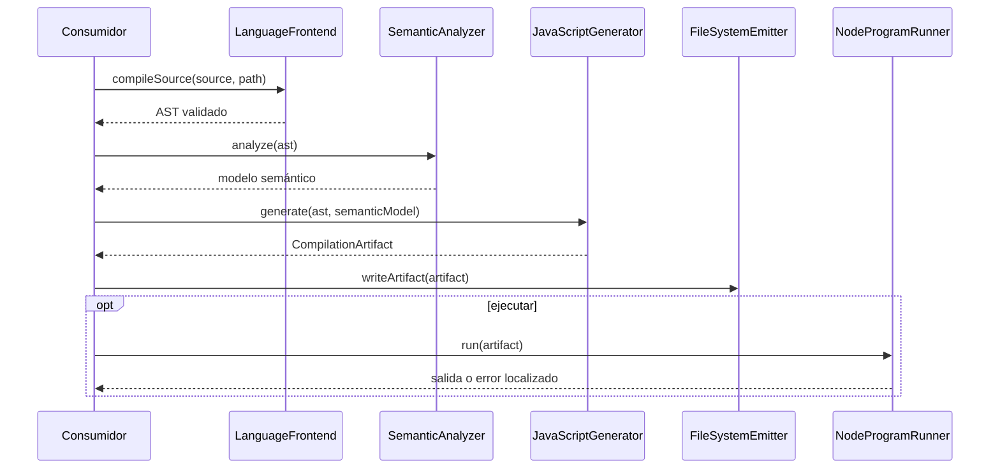

# Compilación y ejecución

Para GUI, el modelo semántico añade una preparación privada antes de la
ejecución. El addon nativo se valida y carga en procesos Node separados.
El comando **Generar código JavaScript** crea `app/<nombre-del-programa>/`:
publica un proyecto npm CLI de tres archivos o un proyecto GUI de cinco
archivos, en ambos casos con lock generado por npm. Sólo GUI incorpora helpers
de build packable y runtime gráfico.
Las autoridades de estos recorridos son el [pipeline GUI](../gui/runtime-pipeline.md)
y la [exportación autónoma](../gui/javascript-export.md); el diseño de
empaquetado está en el
[contrato de ejecutable portable](../gui/portable-executable-export.md).
La separación prevista entre perfiles CLI y GUI, incluido el estado previo a
su implementación, está fijada en la
[auditoría de exportación CLI compilable](cli-executable-export.md).

## Compilación, transpilación y ejecución

[`CompilationService`](../../src/compiler/services/CompilationService.js) es la fachada principal:



### Componentes

| Archivo | Responsabilidad |
|---|---|
| `CompilationArtifact.js` | Une AST, origen, JavaScript generado y destino. |
| `JavaScriptGenerator.js` | Generador moderno basado en visitantes. |
| `JavaScriptIdentifierResolver.js` | Proyecta bindings CLRS a identificadores JavaScript internos y libres de colisiones. |
| `Transpiler.js` | Fachada histórica conservada para consumidores existentes. |
| `FileSystemEmitter.js` | Escritura de artefactos permanentes o temporales. |
| `NodeProgramRunner.js` | Ejecución aislada como proceso Node.js. |
| `RuntimeLocationInstrumentation.js` | Mapea errores JavaScript a ubicaciones CLRS. |
| `RuntimeStateInstrumentation.js` | Captura estado para trazas y DAP. |
| `StandartLibrary.js` | Runtime JavaScript inyectado de la biblioteca estándar. |

Las exportaciones permanentes solicitadas por **Generar código JavaScript** se
ubican bajo `app/<nombre-del-programa>/`. El nombre de carpeta y el archivo de
entrada comparten un identificador legible y portable derivado del nombre del
documento. La misma identidad canónica resuelve la raíz `app`, el directorio del
proyecto, el archivo de entrada y su ruta final para las ramas GUI y no GUI, sin
la clave interna que protege a los temporales. Una ejecución
temporal conserva su ruta privada y se limpia al finalizar cuando el artefacto
fue marcado como temporal.

Una exportación CLI publica el entry normal, `package.json` y
`package-lock.json`. Tras `npm ci`, `npm start` ejecuta directamente el mismo
JavaScript; la instalación incorpora la herramienta local de build, no GTK ni
helpers packable. El ensayo opt-in `npm run test:cli:install:native` comprueba
este recorrido en un proyecto trasladado fuera de su origen. Los scripts host
construyen `dist/<programa>.exe` en Windows o `dist/<programa>` en Linux/macOS.
`npm run test:cli:build:native` ejecuta el binario aislado y valida su interfaz
de consola sin introducir wrappers ni cross-compilation.

Una exportación GUI publica el entry normal, `prepare-packable.cjs`,
`bootstrap.cjs`, `package.json` y `package-lock.json`. La operación sólo genera
metadatos del lock: no instala módulos, no ejecuta scripts nativos y no crea
`dist/`. Tras `npm ci`, `npm start` usa directamente el entry normal. Los
scripts `build:win` y `build:unix` derivan una variante packable sin modificar
ese entry y reservan `dist/<programa>/` para el ejecutable construido en el
host.

`JavaScriptExpressionVisitor` transpila recursivamente cada `ArrayExpression` a un literal JavaScript equivalente. Esto permite usar arreglos vacíos, valores anidados y expresiones en asignaciones, argumentos, retornos y llamadas de biblioteca sin introducir una ruta de ejecución especial. Cada evaluación materializa las colecciones internas como arreglos independientes y conserva la instrumentación de ubicación, estado y cobertura del código CLRS original.

`src/compiler/Pipeline.js` y `BrowserPipeline.js` mantienen APIs históricas; las nuevas capacidades deben preferir `LanguageFrontend` y `CompilationService`.

### Presentación de terminal y tiempo de ejecución

La terminal integrada ejecuta `node clrs-cli.js archivo.clrs`. La capa
`src/application/presenters/TerminalUI.js` centraliza símbolos, separadores,
colores y controles de línea. `ConsolePresenter` presenta errores anteriores
al lanzamiento; `NodeProgramRunner` presenta el encabezado y resultado del
proceso generado. Los errores que el runner ya presentó no se repiten.

```text
● CLRS Runtime
────────────────────────────────────────────────────────────
▶ programa.clrs

Hola, CLRS

────────────────────────────────────────────────────────────
✓ Estado: Correcto
⌛︎Tiempo: 180 ms
```

`ESCRIBIR` conserva su contenido, sin prefijos ni colores añadidos. `LEER`
utiliza la entrada estándar existente. Los símbolos de resultado son `✓`
para éxito, `✕` para error y `■` para cancelación; `!` representa advertencias.
Los colores sólo se aplican a mensajes de CLRS en TTY. `NO_COLOR` elimina el
color, conservando actualizaciones de línea si la salida sigue siendo TTY.
Una salida redirigida contiene texto sin ANSI ni frames de animación.

El tiempo usa `process.hrtime.bigint()` entre los eventos `spawn` y `close`
del hijo y se redondea a milisegundos. Incluye la vida del proceso Node,
incluyendo inicialización, entrada humana y ventanas GUI abiertas. Excluye
lexer, parser, semántica, transpilación, preparación del runtime privado y
limpieza posterior. Se presenta en éxito, error de runtime o cancelación
cuando el proceso comenzó; los errores previos o de arranque no tienen tiempo.

`GuiRuntimeProgressPresenter` y `TerminalSpinner` presentan la preparación
anterior al proceso, según el [contrato GUI](../gui/runtime-pipeline.md#61-experiencia-de-primera-ejecución).
La exportación JavaScript autónoma no incorpora esta interfaz del CLI.

### Identificadores higiénicos

CLRS y JavaScript no comparten el mismo espacio válido de identificadores. Nombres legítimos en CLRS como `var`, `function`, `class` o `await` no pueden emitirse literalmente como bindings JavaScript. Además, un identificador de usuario como `console` o `process` podría colisionar con el runtime aun sin ser una palabra reservada.

La compilación resuelve este límite mediante `JavaScriptIdentifierResolver`:

1. `SemanticAnalyzer` produce el símbolo y ámbito de cada identificador.
2. Cada binding definido por el usuario recibe un nombre interno determinista en un espacio que no puede escribirse desde la gramática CLRS.
3. Los visitantes JavaScript usan ese nombre en declaraciones, parámetros, accesos, ciclos y llamadas.
4. Los símbolos externos y las funciones de la biblioteca estándar conservan su nombre de runtime.
5. `RuntimeStateInstrumentation` publica las claves CLRS originales aunque lea el binding interno.

Por ejemplo, la fuente:

```clrs
function(var)
    class = var + 1
    retornar class
```

se emite conceptualmente como:

```js
async function $clrs$0$f$66756e6374696f6e(
    $clrs$1$p$766172
) {
    var $clrs$1$v$636c617373;
    $clrs$1$v$636c617373 =
        $clrs$1$p$766172 + 1;
    return $clrs$1$v$636c617373;
}
```

Este lowering no reescribe el código fuente ni modifica el AST. Diagnósticos, navegación, Inlay Hints, diagramas, complejidad, marcos DAP y variables depuradas continúan mostrando `function`, `var` y `class`. Sólo el artefacto JavaScript usa los nombres internos. Los consumidores que ya poseen un `SemanticModel` deben entregarlo al generador para evitar repetir el análisis.

---

