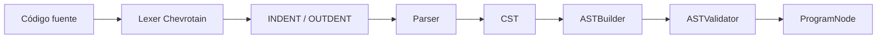

# Frontend del lenguaje

La biblioteca GUI se resuelve desde los símbolos estándar mediante
`GuiUsageDetector` y `GuiSemanticAnalysis`. No introduce sentencias ni cambia
la forma de declarar funciones. `CONECTAR` valida referencias de función y
retorno inmediato cuando el evento lo exige. El literal `NULO` conserva el
valor nulo en AST, ejecución y herramientas.

El contrato especializado está en [runtime GUI](../gui/runtime-pipeline.md)
y [catálogo GUI](../gui/api-catalog.md); sus reglas se mantienen allí.

## Frontend del lenguaje CLRS

### Flujo léxico y sintáctico



| Fase | Entrada principal | Resultado |
|---|---|---|
| Tokenización | `src/lexer/Lexer.js` | Tokens Chevrotain. |
| Indentación | `src/lexer/Indentation.js` | Tokens estructurales de bloque. |
| Parseo | `src/parser/Parser.js` | CST o errores sintácticos localizados. |
| Construcción | `src/ast/builders/ASTBuilder.js` | Árbol de nodos tipados. |
| Validación | `src/ast/validation/ASTValidator.js` | AST estructuralmente válido. |
| API compartida | `src/language/LanguageFrontend.js` | `{ sourceCode, tokens, cst, ast }`. |

La gramática se distribuye por dominio dentro de `src/parser/`: declaraciones, expresiones, control, entrada/salida, llamadas y sentencias. Los tokens siguen la misma separación en `src/lexer/tokens/`.

### Invariante de sintaxis vigente

La sintaxis actual sigue CLRS moderno:

```clrs
resultado = SUMA(10, 20)   // asignación
frutas = ["manzana", "pera", "uva"]
matriz = [[1, 2], [3, 4]]

si resultado == 30         // comparación de igualdad
    escribir resultado
```

Los literales de arreglo utilizan corchetes y separan sus elementos mediante comas. Admiten `[]`, expresiones heterogéneas y anidamiento arbitrario; no admiten elementos ausentes ni una coma final. `matriz[fila][columna]` continúa siendo un acceso sobre un identificador, mientras `[[1, 2], [3, 4]]` es un valor literal: formas como `[1, 2] [3]` o `[[1], [2]][0]` son inválidas y deben expresar sus dimensiones interiores con comas. `<-` es sintaxis histórica y no debe reintroducirse. Un cambio de operador requiere revisar lexer, parser, TextMate, snippets, ejemplos curriculares, pruebas y consumidores visuales.

### AST

Los nodos concretos viven en:

- `src/ast/declarations/`;
- `src/ast/expressions/`;
- `src/ast/statements/`.

`ASTVisitor` ofrece el recorrido base. Los analizadores y generadores deben extender esa abstracción o delegar en visitantes específicos, evitando volver a interpretar el CST. `ArrayExpressionNode` conserva una lista ordenada de expresiones en `elements`; cada elemento puede ser otro `ArrayExpression`, una llamada, un acceso, un literal o cualquier otra expresión válida. Las ubicaciones abarcan desde el primer `[` hasta el `]` correspondiente y se conservan mediante `LocationHelper` para diagnósticos, navegación, runtime y depuración.

### Semántica

El análisis semántico está dividido en dos recorridos:

| Componente | Función |
|---|---|
| `SemanticBindingCollector` | Registra funciones, parámetros, variables implícitas y ámbitos. |
| `SemanticReferenceResolver` | Resuelve usos, llamadas y referencias contra bindings visibles. |
| `SemanticAnalyzer` | Coordina ambos recorridos y produce `SemanticModel`. |
| `SemanticNavigationIndex` | Índice para símbolos, definiciones, referencias y rename. |

Las variables conservan la semántica de ámbito de función del JavaScript generado. Las funciones no pueden redeclararse con el mismo identificador. Ambos recorridos semánticos descienden por todos los elementos de un literal de arreglo: las referencias, llamadas, diagnósticos de identificador indefinido, definiciones, rename, tokens semánticos, hover y firmas utilizan el mismo `SemanticModel`, incluso en dimensiones anidadas. El analizador no pretende ser un sistema de tipos estático completo.

---

