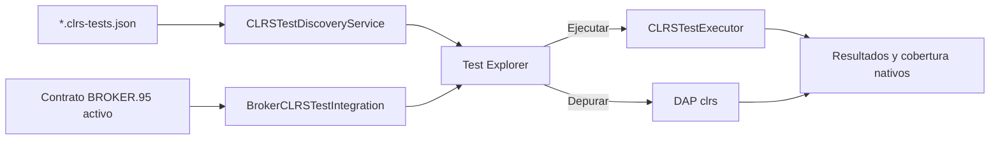

# Marco de pruebas CLRS

Los casos GUI preparan el runtime una vez por solicitud y ejecutan cada caso
en un proceso aislado con su cobertura y límites. Una interacción pendiente
puede agotar el tiempo; el framework no inventa respuestas del usuario.
Los fallos de infraestructura se distinguen de diferencias de salida.
El contrato compartido con BROKER.95 está documentado en
[pruebas y evidencias GUI](../../test/fixtures/gui/testing-evidence.md).

## Explorador de pruebas CLRS

La extensión integra los programas CLRS con la Testing API nativa de VS Code. El panel de pruebas es una proyección de fuentes declarativas; no contiene un segundo compilador, un runtime alternativo ni lógica de evaluación propia.



### Capas y responsabilidades

| Capa | Componentes principales | Responsabilidad |
|---|---|---|
| Dominio | `src/testing/domain/` | Suites, casos, comparadores, divergencias, explicaciones, cobertura y resultados inmutables. |
| Formato | `src/testing/declarative/` y `extension/schemas/clrs-tests.schema.json` | Decodificación estricta y validación editorial de `*.clrs-tests.json`. |
| Descubrimiento | `src/testing/discovery/` | Índice neutral, refresco y aislamiento de definiciones inválidas o programas ausentes. |
| Ejecución | `src/testing/execution/` | Análisis CLRS, generación JavaScript instrumentada, proceso determinista, límites, comparación y evidencia de cobertura. |
| VS Code | `extension/testing/` | Árbol nativo, perfiles Ejecutar/Depurar/Cobertura, cancelación, diferencias, salida y detalles por archivo. |
| BROKER.95 | `BrokerCLRSTestIntegration` | Proyección temporal de los casos públicos del contrato activo sobre el mismo árbol y ejecutor. |

### Formato declarativo

Una suite se guarda junto al proyecto con el sufijo `.clrs-tests.json` y referencia un programa `.clrs` mediante una ruta relativa:

```json
{
  "version": 1,
  "id": "suite:suma",
  "name": "Pruebas de suma",
  "program": "suma.clrs",
  "cases": [
    {
      "id": "case:positivos",
      "name": "Suma dos positivos",
      "input": ["5", "8"],
      "expectedOutput": ["13"],
      "comparison": "number",
      "timeoutMs": 5000
    }
  ]
}
```

`input` y `expectedOutput` son arreglos de líneas. Una lista no vacía se normaliza con un salto de línea final; una lista vacía representa texto vacío. `comparison` es opcional y utiliza `exact` de forma predeterminada. El dominio también admite texto recortado o normalizado, líneas ordenadas o no ordenadas, números exactos o con tolerancia, JSON, arreglos con o sin orden, booleanos, inclusión y regex segura. `timeoutMs` es opcional, parte de 5000 ms y permanece entre 1 y 60000 ms. El decodificador rechaza campos adicionales, rutas absolutas, versiones desconocidas, controles inseguros, límites excesivos e identificadores duplicados.

La activación `workspaceContains:**/*.clrs-tests.json` permite descubrir suites aun antes de abrir un archivo CLRS. Los watchers sólo reaccionan a definiciones y programas relevantes; cada cambio reemplaza el snapshot completo y cancela refrescos obsoletos del mismo archivo. El `TestController` y sus perfiles nativos se construyen de forma diferida: permanecen ausentes hasta descubrir una suite declarativa o casos públicos de un contrato BROKER.95.

### Ejecución y resultados

`CLRSTestExecutor` recibe código, versión documental, suite, selección de casos, semilla y señal de cancelación. Reutiliza `DocumentAnalysisService` y el generador JavaScript vigente. Si el código contiene errores sintácticos o semánticos, produce resultados localizados sin iniciar Node.js. Si es válido, ejecuta los casos secuencialmente mediante `CLRSNodeTestProcessRunner` con entrada estándar controlada, `Math.random` sembrado, timeout por caso, presupuesto total y salida acotada.

`CLRSTestResultPresenter` traduce cada resultado a estados nativos aprobados, fallidos, erróneos, omitidos o cancelados. La salida de la prueba incluye entrada, salida esperada, salida real, stderr, duración y semilla. Cada bloque elimina únicamente su terminador de línea final antes de aplicar la separación visual, por lo que conserva líneas vacías pertenecientes a la evidencia sin producir espacios dobles entre secciones. Los fallos de aserción usan la comparación visual de VS Code, conservan la primera divergencia estructurada y agregan una explicación pedagógica determinista separada del diagnóstico técnico. Los diagnósticos con ubicación enlazan al programa CLRS.

El perfil **Depurar** admite un único caso por sesión. Inyecta su entrada y semilla en la configuración DAP privada, inicia el mismo adaptador `clrs`, conserva pausa, breakpoints y pasos, y espera un evento `test-result` antes de cerrar el `TestRun`. La cancelación se correlaciona mediante un ID por lanzamiento y nunca detiene una sesión DAP ajena.

### Cobertura por prueba y acumulada

La generación JavaScript incorpora puntos de instrumentación estables para instrucciones, declaraciones y condiciones, sin cambiar el resultado observable del programa. `CLRSNodeTestProcessRunner` recoge evidencia acotada por proceso; `CLRSTestExecutor` la normaliza contra el catálogo fuente y produce cobertura aun cuando un caso no alcance todos los puntos.

`CLRSTestCoveragePresenter` publica conteos y rangos mediante la Coverage API de VS Code, conserva detalles por caso y acumula únicamente ejecuciones del mismo archivo y versión documental. `CLRSTestCoverageStore` expone esa proyección al diagrama enlazado, que representa estados ejecutado, parcial o no ejecutado sin implementar una segunda métrica. Evidencia ausente, truncada o perteneciente a una versión obsoleta se marca como incompleta en lugar de inferirse.

### Integración con BROKER.95

Sólo el contrato actualmente activo se proyecta como raíz `BROKER.95 · <título>`. El árbol recibe identificador, tipo y explicación de cada caso público; entrada, expectativa, comparación y timeout se materializan en el Extension Host únicamente al ejecutar o depurar. Al activar, resolver, borrar, purgar o reemplazar el contrato, la suscripción a `BrokerGameSession` reconcilia el árbol de inmediato.

La ejecución resuelve el documento CLRS activo o enlazado mediante `VSCodeBrokerDocumentHost`, crea una suite efímera y delega en `CLRSTestExecutor`. Los comparadores validados de BROKER.95 —texto, líneas, números, tolerancia, JSON, arreglos, booleanos, inclusión y regex segura— comparten `compareCLRSTestOutput`; no existe una segunda implementación de la rúbrica funcional.

Los programas evaluados por BROKER.95 pueden inicializar arreglos y matrices mediante literales. La evidencia estática desciende por `ArrayExpression` para conservar símbolos, llamadas, accesos y métricas sin asignar calificaciones automáticas. Las lecciones existentes **Crear y actualizar arreglos** y **Arreglos multidimensionales** presentan `A = [10, 20, 30]`, `A = []` y matrices con literales anidados, manteniendo también la construcción incremental y la actualización por índices; no se agregó una ruta curricular ni una lección paralela.

Ejecutar o depurar desde el Test Explorer no muta contrato, progreso, saldo, alerta, estadísticas ni evaluación. `ai -review` y `ai -push` conservan sus propias transiciones autoritativas y pueden reutilizar el mismo runtime determinista sin confiar en un resultado publicado por la UI.

---

